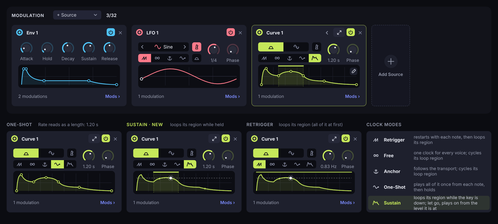
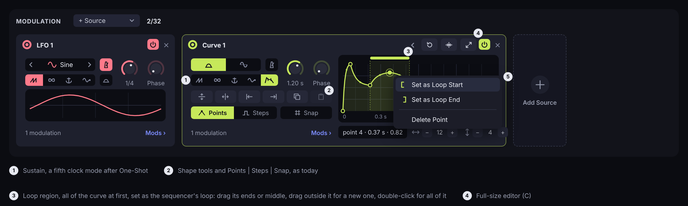
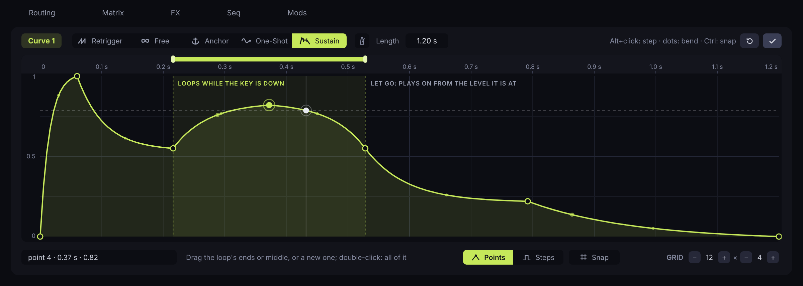
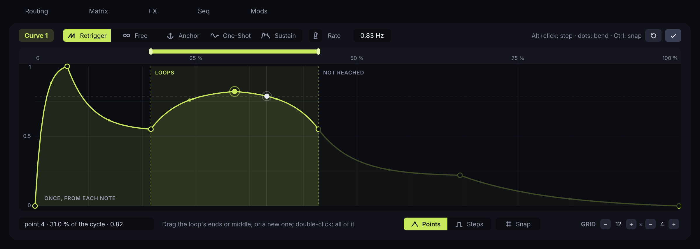
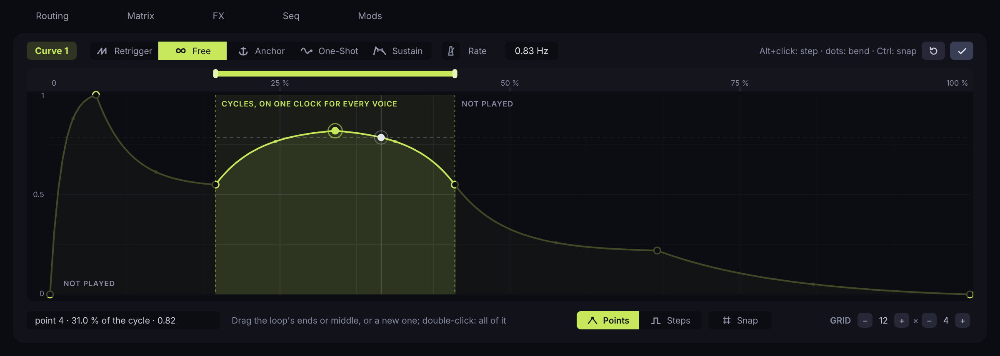
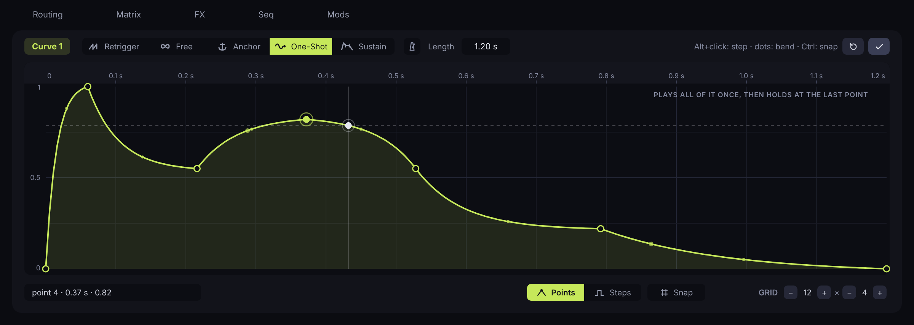
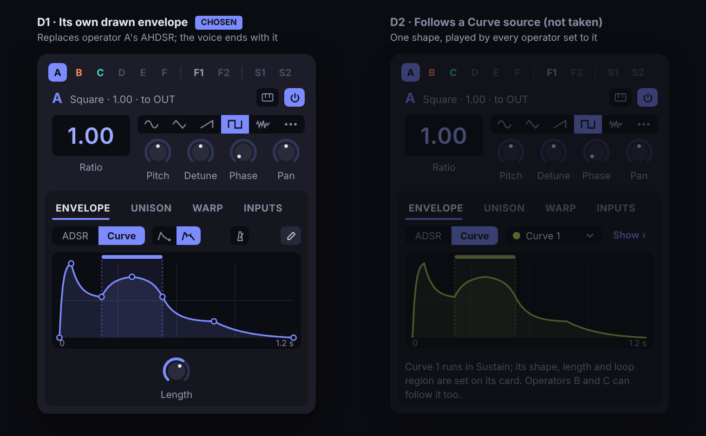
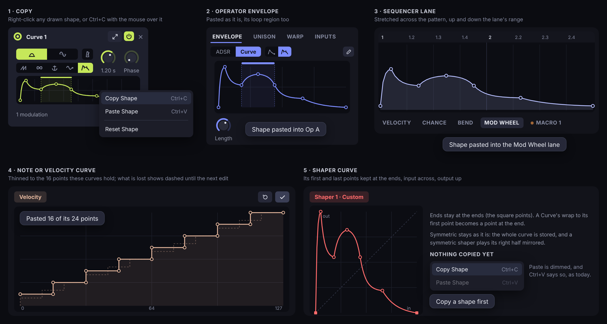

# Curve with Sustain, loop regions, drawn operator envelopes and shape copy/paste — implementation plan

**What this is.** A handoff for the agent that builds these features. It describes the behaviour that was decided, the
code to change (with file:line pointers taken at `abac037`, so check them against the tree you have), the stored
data, the tests and the docs. Read `AGENTS.md` first: its rules on parameter ids, stored lists, the state version,
both platforms, `uistrings.inc`, the theme's scales and the tests all apply. Delete this file (and
`docs/curve-sustain-plan/`) once the work is ordinary history; `docs/features.md` and `docs/manual.md` describe the
result.

**Where it came from.** The user wanted an MSEG (multi-segment envelope generator). The Curve source already does
most of what an MSEG does: a shape drawn from 2 to 64 points with bends and steps, its grid, Snap, point picking,
shape tools, a widened card and a full-size editor, Rate or a synced note value, and Retrigger / Free / Anchor /
One-Shot. It lacks one thing: it never hears a key go up. So there is **no new source type**. The Curve gets a
Sustain clock mode and a loop region; operators get envelopes drawn the same way; and shapes copy and paste between
every drawn curve. The visual drafts below were made on a design canvas and rendered into
`docs/curve-sustain-plan/`; they show the look and the controls, not exact pixels (they were drawn in HTML, in the
Spectrum theme, from the real card geometry in `src/gui/layout.h`).

**Phases.** Build and land them in order; each one is useful on its own and keeps `ctest` green.

1. The Curve source's loop region and Sustain clock mode, in the engine and the stored params.
2. The Curve's editor: the fifth clock-mode button, the loop bar edited as the sequencer's loop, the point menu's
   loop entries, the ruler and the Rate shown as a length.
3. Drawn operator envelopes (the ENVELOPE tab's **ADSR | Curve** switch).
4. Copy and paste between every drawn shape.

---

## Decisions (made with the user; don't reopen them)

| Topic | Decision |
| --- | --- |
| MSEG | No new source type. The Curve source grows the missing parts. |
| Clock modes | A fifth, **Sustain**, after One-Shot, on Curve cards only. LFO and Random cards keep theirs. |
| Curve card's clock modes and polarity | **A list (a dropdown)**, not a row of buttons: the clock mode picked from a list button where the Curve card's Unipolar \| Bipolar is now (an LFO's shape list's place). Its polarity becomes **the LFO's Unipolar switch**, under the sync button. (Added after Phase 2 landed.) |
| Loop region | Every Curve has one: a start and an end along the curve. A new Curve's (and every existing patch's) is the **whole curve**, so nothing plays differently until it is moved. |
| Retrigger | Plays from where notes start it (Phase), then loops the region. With the whole curve as the region, as today. |
| Free, Anchor | Cycle only the region. |
| One-Shot | Ignores the region: plays the whole curve once, then holds, as today. |
| Sustain | Plays from Phase to the region and loops it while the key is down (or the sustain pedal holds the note). Let go, it leaves the loop **at once** and plays on from the level it is at, as a DX7's envelope releases (it goes to its last stage from wherever it is). It holds at the curve's end. A voice runs on until the curve has ended, as it does for a releasing mod envelope. |
| Nothing after the loop | (The loop ends at the curve's end, as a new Sustain curve's does.) Let go, it **glides to the last point over a few ms** rather than jumping. |
| Setting the loop | **As the sequencer's loop is set**: a bar on a ruler over the shape, its ends dragged to size it and its middle to move it, a drag across the ruler outside it drawing a new one, a double-click looping the whole curve, snapped to the grid's columns, its ends staying a column apart, what isn't played shaded. **With Shift or Ctrl held**, a drag of the loop or either end goes **without snapping**, wherever the mouse is (as a note moved with Shift does in the sequencer). |
| Point menu | A point's right-click menu adds **Set as Loop Start** and **Set as Loop End** (beside today's Delete point). They put that end exactly at the point, on the grid or not. |
| Rate as a length | In One-Shot and Sustain, unsynced, the Rate knob and the editors read and take a length (1.20 s) instead of Hz. Rate stays the whole curve's length in every mode, so the region plays at the speed it is drawn: a loop half as long comes round twice as often. |
| Operator envelopes | Each operator can draw its own envelope: the ENVELOPE tab's **ADSR \| Curve** switch (variant D1 in the drafts; following a Curve source, D2, was not taken). Its own One-Shot \| Sustain, loop region and length. |
| Copy and paste | Between every drawn shape: Curve sources, operator envelopes, voice shaper and shaper effect curves, the note source's and velocity's curves, and the sequencer's lanes (bend, mod wheel, macros). |
| Paste into a symmetric shaper | Symmetric stays as it is. The whole curve is stored; a symmetric shaper plays its right half mirrored, and its left half is there if Symmetric is switched off. |

## The drafts

| | |
| --- | --- |
|  | **A · The Curve card.** Five clock modes (Sustain last, lit). Rate reads 1.20 s in One-Shot and Sustain, Hz in Retrigger. The display shows the loop region as a bar and a band. Below: the card in One-Shot, Sustain (playing: the newest voice bright, a voice let go past the loop) and Retrigger (its region the whole curve). |
|  | **B · The widened card.** The loop bar over the plot, time under it, the point readout in seconds. Pin 5: a point's right-click menu with Set as Loop Start / Set as Loop End / Delete Point. |
|  | **C · The full-size editor, Sustain.** The five clock modes and sync in its title row, then Length; a ruler with the loop bar (seconds); the band loops while the key is down. |
|  | **C · Retrigger.** The part before the region plays once from each note; what comes after the region is shaded (never reached). Rate in Hz, the ruler in % of the cycle. |
|  | **C · Free (Anchor alike).** Only the region cycles; both sides shaded. |
|  | **C · One-Shot.** No loop bar: it plays the whole curve once and holds at its end. |
|  | **D · Operator envelope.** D1, chosen: **ADSR \| Curve**, One-Shot \| Sustain, the drawn envelope with its loop region, a pencil for the full-size editor, a Length knob. D2 (greyed) was not taken. |
|  | **E · Copy and paste.** 1 Copy from a shape's right-click menu or Ctrl+C. 2 Into an operator envelope, as it is. 3 Into a sequencer lane, across the pattern. 4 Into the velocity curve, thinned to 16 points. 5 Into a shaper, its ends kept at the ends, and Paste dimmed while nothing is copied. |

In the drafts the Sustain loop's ends sit on two points that aren't on the 12-column grid; that is a loop set with
the point menu. A loop dragged on the ruler snaps to the columns, unless Shift or Ctrl is held.

---

## Phase 1 — The Curve's loop region and Sustain, in the engine

### Stored params

Append three fields to `SourceParam` (`src/params.h:195-229`, after `Anchor`), in this order:

| Field | Kind | Range | Default | Used by |
| --- | --- | --- | --- | --- |
| `Sustain` | Toggle (like `OneShot`, `params.cpp:1008`) | 0..1 | 0 | Curve |
| `LoopStart` | continuous, hidden, not automatable, **not a modulation target** | 0..1 of the curve | 0 | Curve |
| `LoopEnd` | as LoopStart | 0..1 | 1 | Curve |

- Ids: the first 16 places have 6 spare fields in their `2800 + 40·place` block, so these land at
  `2834..2836 + 40·place` (`idOfIndex()` `params.h:1721-1728`; constants `1653-1662`). Places 16-31 go at
  `58000 + 100·(place - 16) + field` (42 spare). Update the static_asserts that pin the last source field
  (`params.h:1804-1805`, `1890-1902`, `2020-2036`).
- `sourceFieldUsedBy()` (`params.h:1172-1203`): give the three fields their own case (Curve only). Its `default:`
  branch would otherwise count them as an envelope's fields.
- Keep LoopStart/LoopEnd out of modulation: `isModTarget()` (`params.h:2850-2855`) takes any continuous param below
  `kMacroBase`, so give them a kind that isn't continuous for it, as the shapes' points are (`ShapePoint`, flagged in
  the `add` lambda `params.cpp:225-262`), or exclude them there. Source fields are never given to hosts
  (`hostList()` `params.cpp:1300-1329`), so the host's param count doesn't change.
- `kParamCount` grows by 96: `params.cpp:44` asserts `38008` and a bound of `13 * 3000`; `idsRoundTrip` chunks
  (`params.cpp:45-70`) reach 39000. Update the number (and AGENTS.md's 38,008 and features.md's, see Docs).
- **State version: no new step.** `kStateVersion` is 17 (`src/state.cpp:90`) and was already raised since the last
  tag (v0.16 = `2703d74`; the step came with `abac037`). Params a state doesn't hold keep their defaults
  (`readParams`, `state.cpp:660-663`), and the defaults (Sustain off, the whole curve) play every older patch as it
  played. If a load step turns out to be needed, it joins step 17 (AGENTS.md: at most one rise between tags).

### Clock modes

- `enum class LfoClock { Retrigger, Free, Anchor, OneShot, Count }` (`params.h:1241`) is derived from the switches,
  not stored. Add `Sustain` before `Count`. `lfoClock()` (`params.h:1239-1251`): for a Curve source, Sustain wins,
  then One-Shot, then Anchor, then Free; other source types ignore the Sustain switch (as Random ignores Anchor and
  One-Shot, `kRandomClocks`). `lfoOneShot()`, `lfoShared()`, `lfoAnchored()` (`params.h:1224-1238`): a Sustain Curve
  is neither shared nor anchored nor a one-shot.
- `kLfoModes = LfoClock::Count` (`gui/layout.h:858`) sizes the LFO card's clock row and everything placed off it
  (`lfoShapeButton` 865, `randomPolaritySwitch` 883, `lfoKnob` 891, `sourceSync` 896, `lfoUnipolarSwitch` 903).
  Raising `Count` to 5 must not move the LFO card: keep the LFO row's 4 as its own constant (Phase 2 lays out the
  Curve's five).

### Running it

All of it lives where the LFOs run; the Curve is an LFO of the retired Custom shape (`lfoShape()` `params.h:1210`,
`lfoOutput()` `synth.cpp:153-160` → `shapeValue()` `params.h:2496-2512`).

Let `a = LoopStart`, `b = LoopEnd` (clamped to 0..1, `a <= b`). With `a = 0, b = 1` every rule below must give
exactly today's phases, bit for bit (see Tests).

- **Retrigger** (`advanceLfo()` `synth.cpp:410-421`, the per-voice step `synth.cpp:2910-2938`): starts at Phase as
  today; once the phase reaches `b`, it wraps into the region: `phase = a + fmod(phase - a, b - a)`. Today's wrap
  (`phase -= floor(phase)`) is the case `a = 0, b = 1`. A region of zero length (`a == b`, which only a host or a
  state can make; the editor keeps a column between the ends) holds at `a`.
- **Free** (`runSharedLfos()` `synth.cpp:1334-1374`): the shared clock wraps the same way, inside the region.
- **Anchor** (`synth.cpp:1364-1372`, today `at = cycles + Phase; phase = frac(at)`): count cycles of the region:
  `phase = a + (b - a) · frac((cycles + Phase - a) / (b - a))`, where `cycles` is computed as today (song beats over
  the division, or song seconds times the rate). It reduces to today's formula for `a = 0, b = 1`.
- **One-Shot**: unchanged (holds at the cycle's end; `shapeValue` wraps the last segment to the first point unless a
  point sits at x = 1, `params.h:2508`).
- **Sustain** (per voice):
  - From the note's start at Phase, run forward; while the voice isn't released, wrap into the region as Retrigger
    does.
  - **On release** (whatever the phase: in the part before the region or in the loop): note the level the source
    puts out now, `L`, then set `phase = b` and play on from there with an **offset** `L - curve(b)` that fades
    linearly to 0 by the next point after `b` (so the first segment after the loop starts at `L` and lands exactly
    on the next point, keeping its bend roughly). If nothing comes after the loop (`b` is the curve's end), fade the
    offset over a few ms instead (5 ms is a fine start; name it as a constant).
  - At the curve's end (`phase = 1`), hold there, as One-Shot does.
  - The LFO state (`Synth::Lfo`, `synth.h:394-400`) needs a released flag and the offset (start value and how far it
  has faded). `releaseVoice()` (`synth.cpp:732-738`) releases the operators' and mod envelopes' today; add the
  voice's Sustain Curves there. A pedal sets `sustained` instead of `released` (`letGo`, `synth.cpp:608-613`), so a
  held pedal keeps looping, as wanted. A mono voice taken over is moved and un-released by `moveVoice()`
  (`synth.cpp:693-719`): mirror what it does to the mod envelopes (a retrigger restarts the LFOs, `restart`; a legato
  move without one keeps them where they are).
- **The voice's lifetime**: a released voice whose sound is over runs on only while a mod envelope that modulates
  something releases (`modEnvReleasing()` `synth.cpp:4047-4058`, used at `3128` and `4040`). Extend it (and rename
  it, say `modulationReleasing()`) to include an enabled Curve in Sustain, released, that hasn't reached its end and
  has a live slot (a target, a non-zero amount, not bypassed), so its targets follow it down and the voice reports
  `NOTE_END` only after.
- **The effects' tail** (`fxTailBlock()` `synth.cpp:1293-1332`) advances a dead voice's non-free LFOs with
  `advanceLfo(..., lfoOneShot)`: give it the same region and Sustain rules (the voice is released by then).
- **Telemetry** (`lfoPhases`/`lfoRates`, `synth.cpp:1668-1673`, `1710-1715`) carries the phase the card's dot is
  drawn at. During a Sustain release offset the level isn't `curve(phase)`; either send the level too or the offset,
  so the dot and the dashed level line (as on the envelope card) sit where the voice really is.

### Tests (Phase 1)

In `tests/smoke_host.cpp` (it plays notes through the CLAP plugin; find the LFO / Curve / clock-mode checks and add
beside them), and `tests/quality.cpp` where a check measures sound:

- A Curve with its region the whole curve plays **bit for bit** as before in every clock mode (render a note with a
  Curve on a param and compare with the previous formula, or keep a pinned render of the old behaviour inside the
  test). On Windows, also run `tools\bench.ps1 -Commits HEAD~1,HEAD`: every factory preset must render bit for bit.
- Retrigger with a region `[0.25, 0.75]`: after the first pass, the target moves only through the region's values,
  at the drawn speed (the loop comes round every `(b - a) / rate`).
- Free and Anchor cycle only the region; Anchor's phase from the transport follows the formula above (a synced one
  at its Phase on the region's beats).
- Sustain: loops while the key is down; a key let go mid-loop leaves at once, starting from the level it was at (no
  step larger than the curve's own), plays the rest and holds at the end; a voice runs on until then and reports
  `NOTE_END` once, after; the sustain pedal holds it in the loop; with nothing after the loop it glides to the last
  point over the few ms; mono legato and retrigger behave as for the mod envelopes.
- A region of zero length holds; a region set by a state outside 0..1 or reversed is clamped and stays finite.
- One-Shot unchanged.

---

## Phase 2 — The Curve's editor

### The card's fifth clock mode

(Built in `2d124d3`. The card's row of five buttons is to become a list: see "The Curve card's clock modes as a list"
below. What follows stays true of the full-size editor's title row, the icon, the tips, the wheel and
`setLfoClock()`.)

- Curve cards have no Unipolar switch at the clock row's right (Random and Curve put Unipolar | Bipolar where the
  LFO's shape list is), so the Curve's row widens under the sync button: five buttons across 152 px, each as wide as
  an LFO's (draft A). LFO cards keep four across 122 px with the Unipolar switch beside them; Random keeps its two.
- Widgets: `view.cpp:1608-1612` (the clock Choices, `param = paramIndex(s, SourceParam::Free)`, count from
  `lfoClockCount()` `view.cpp:922`); painting `view.cpp:4242-4245`, `4305-4307`; icon `lfoClockIcon()`
  (`gui/icons.cpp:304-343`): add Sustain's (a rise, a level between two ticks, a fall, as drawn); tooltip array
  `view.cpp:5677-5679` (`TipRetrigger`..`TipAnchor` `uistrings.inc:1218-1221`; add `TipSustain`); wheel
  `view.cpp:7627-7631`.
- `View::setLfoClock()` (`view.cpp:927-939`) turns the chosen switch on and the others off in one `editMany`: add
  Sustain to the switches it sets.

### The loop region, edited as the sequencer's loop

The sequencer's loop is the model (`src/gui/seqpanel.cpp`; nothing there is shared code, so mirror it in
`ShapeEditor`):

| Sequencer | Where | Curve's loop |
| --- | --- | --- |
| `Kind::SeqRuler` widget | `seqpanel.cpp:515` | a ruler strip over the full-size plot; on the widened card, a strip at the plot's top where the bar is |
| `seqRulerMode(x)`: within 6 px of an end → that end, inside → move, else a new loop | `2962-2970` | the same |
| press | `1636-1643` | the same, in columns |
| drag: a new loop at least a step long; move keeping the length, clamped; ends `min(at, end - 1)` / `max(at, start + 1)` | `2049-2074` | the same with grid columns (`shapeGridX`) for steps: a column apart |
| double-click: the whole pattern | `2186-2190` | the whole curve (0..1) |
| shading outside the loop, `kBackground.alpha(0.45)` | `2670-2678` | shade what the mode doesn't play: after the region in Retrigger; before and after it in Free and Anchor; nothing in Sustain (draft C) |
| the bar `{x0, ruler.y + 3, x1 - x0, 5}`, `kRadiusMark` | `2680` | the bar in the source's color, as drawn |
| cursors: move inside, horizontal at the ends | `2984-2987` | the same |
| `TipSeqRuler` | `uistrings.inc:1100` | a tip of its own |

- Each drag is one undo step (`editMany` of LoopStart and LoopEnd).
- The bar shows in Retrigger, Free, Anchor and Sustain, not in One-Shot (draft C).
- **Without snapping (added after Phase 2 landed, in `2d124d3`; built since).** With Shift or Ctrl held, a drag
  on the strip doesn't snap: an end goes exactly where the mouse is, the loop moves by exactly as far as the mouse
  has, and a new loop is drawn from where it was pressed to where the mouse is. The modifier is read as the mouse
  moves (`DragState::mods`, as `moveTo()` reads Ctrl for points), so pressing it mid-drag frees the drag from there.
  Freed ends still never meet: they keep at least 1/256 of the curve apart (a zero-length loop is a host's or a
  state's only), and a moved loop stays within the curve. Where it goes: `ShapeEditor::moveTo()`'s
  `DragKind::Loop` case (`loopColumn()` and the column steps there), which takes `d.mods.shift || d.mods.ctrl`.
  The Snap switch doesn't change it: the loop snaps to the columns unless Shift or Ctrl is held, whatever Snap
  says. The strip's tip says so (`TipShapeLoop`, "Drag to set the loop, Shift for free, double-click for the whole
  curve", or as close as reads well). Docs: `docs/features.md` (the shape editor's loop paragraph) and
  `docs/manual.md` (the Curve source's loop list).
- The full-size editor (`paintShapeEditor()` `shapeeditor.cpp:752-812`, widgets `1311-1365`, mouse
  `press` 1653 / `doubleClick` 1806 / `drag` 1841 / `drop` 1925 / `release` 1939, cursor 1607) gains the ruler at its
  plot's top; the widened card (`paintLfoCard()` `shapeeditor.cpp:1244-1294`, `cardWidgets()` 1389-1431,
  `lfoCardPlot()` `layout.h:656-659`) shows the bar over its plot and the time under it (draft B). Mind the
  `shapeAreas_` cache (`shapeeditor.h:290`, `shapeArea()` `.cpp:55-59`).
- The full-size editor's title row gets the five clock modes, sync and the Rate/Length field (draft C); clicking them
  edits the same params as the card. Its hint stays where it is today.

### The point menu

`ShapeEditor::contextMenu()` (`shapeeditor.cpp:1967-1984`) offers **Delete point** on a point today (not on the
first, nor on a curve's last, nor while only two remain); `menuCommand()` (`1986-1996`) runs it. For a Curve
source's shape (`shape < kMaxSources`), on any point, first and last included, add **Set as Loop Start** and **Set as
Loop End** (new command numbers beside `kMenuStraighten = 1`, `kMenuDeletePoint = 5`, `shapeeditor.h:62-63`), each
setting that end to the point's x exactly, one undo step. Leave out an entry that would put the start at or past the
end (or the end at or before the start): `MenuItem` (`widget.h:26-30`) has no disabled state. Delete point stays as
it is.

### Rate as a length, and the readouts

- In One-Shot and Sustain, unsynced, the Rate knob's text and what it takes when typed are a length, `1 / hz`
  (`paintKnob` → `formatParam`, `view.cpp:5244-5245`; `ParamKind::SweepRate` prints Hz at `params.cpp:1401-1402`
  and parses at `1877`). The param stays the rate in Hz, so nothing stored changes. At 0 Hz keep what the knob shows
  today.
- The point readout (`CaptionShapePoint` "…% of the cycle…" `uistrings.inc:1003`, painted at
  `shapeeditor.cpp:801-811`; the card's `CaptionCardPoint`, `1270-1284`) shows seconds in One-Shot and Sustain,
  unsynced, bars and beats when synced (`1.2.1`), and % of the cycle otherwise. The ruler's labels follow the same
  rule (draft C: seconds, %, beats).

### The Curve card's clock modes as a list (added after Phase 2 landed; built since)

The Curve card's controls become an LFO card's, with a list of clock modes in the place of its shape list:

- **The list.** A list button at `lfoShapeButton(card)` (`gui/layout.h`, the LFO's shape list's place and the
  Curve's Unipolar | Bipolar's now, `randomPolaritySwitch()`): the mode in force, its icon (`lfoClockIcon()`) and
  name (`SwitchRetrigger`..`SwitchSustain`, which the full-size editor's title row already uses), and the arrows that
  step along it, round its ends, as the LFO's shape list has (`isSteppableList()`, `listStepButton()`); the wheel
  over it steps along it, as the clock buttons' wheel does now (`view.cpp`, `isLfoClockChoice()` in `wheel()`). Its
  list opens under it, as the shape list's does, with the five modes in order, each its icon and name, the one in
  force checked. The list button shows no tooltip, as an LFO's shape list doesn't (decided with the user after it was
  built with one); its arrows keep their Previous / Next tips.
- **What it edits.** The clock mode isn't one param but the switches `setLfoClock()` sets (Free, Anchor, One-Shot,
  CurveSustain): the list button takes `paramIndex(s, SourceParam::Free)` as the clock Choices do now
  (`isLfoClockChoice()` keys on it), and picking an entry, an arrow or a wheel notch goes through `setLfoClock()`, one
  undo step, never through `edit()` of the param. `gui/lists.h`'s `listCount()`, `listItemValue()` and
  `listItemName()` (and `isSteppableList()`) need a case for it: five entries, valued by `LfoClock`, named by
  `SwitchRetrigger`..`SwitchSustain`; `View`'s list pick (where a `ListItem` is taken) routes it to `setLfoClock()`.
- **The polarity.** The Curve card's Unipolar | Bipolar Choice pair (`view.cpp`, the `random || curve` branch beside
  the shape list) goes for a Curve; it gets the LFO's Unipolar Toggle at `lfoUnipolarSwitch(card)`, under the sync
  button, the same widget, icon and tip as an LFO's (`TipUnipolar`/`TipBipolar`). The param doesn't change (a
  Curve's polarity was its Unipolar already), nor does a new Curve starting unipolar. A Random card keeps its
  Unipolar | Bipolar (its Bipolar) where it is.
- **The second row.** The row under the list, where an LFO's clock buttons are, holds nothing left of the Unipolar
  switch on a Curve card: the display, the knobs and a widened card's tools stay where they are, as every source
  card keeps its controls in an LFO card's places. `lfoModeSwitch()`'s five-wide Curve row (`kCurveModes` there)
  goes. That space stays clear (decided with the user: the display doesn't move up into it).
- **Unchanged.** The full-size editor's title row keeps its five named buttons (it has the room); LFO cards keep
  their shape list, four clock buttons and Unipolar switch; Random cards their two clock buttons and Unipolar |
  Bipolar; the engine and the stored params.
- **Tests** (`tools/uishot.cpp`, `testCurveLoop`): the list button shows the mode in force; its list opens with the
  five, one checked, and picking Sustain sets the switches as `setLfoClock()` does, one undo step; its arrows and the
  wheel step along it (round its ends for the arrows); its tooltip; the Unipolar switch under the sync button flips
  the Curve's Unipolar, undoably, and the card shows no Unipolar | Bipolar pair (read off the rendered pixels); an
  LFO card beside it unchanged (its four clock buttons and Unipolar switch where they were). The Phase 2 replays that
  click the Curve's clock buttons (`sustainToggle`, `oneShotToggle(0)`, `retriggerToggle(0)` on a Curve card, and
  the `randomPolaritySwitch` clicks on Curve cards in `testWideLfoCard` and around `uishot.cpp:15034`) go through the
  list and the switch instead.
- **Docs.** `docs/features.md` (the source cards' paragraph on the clock modes and the Unipolar switch, and the
  Curve's Sustain bullet that says it is the fifth button) and `docs/manual.md` (the Curve source section).

### Tests (Phase 2)

New replays in `tools/uishot.cpp`, beside `testWideLfoCard` (`4558-4726`) and the full-size Curve editor replay in
`runMore` (`1589-1618`), and the clock-mode replays in `run()` (`12718-12740`):

- The Curve card's five clock modes: a click on Sustain lights it and turns the others off, one undo step; the wheel
  steps along the five; its tooltip. The LFO card's four buttons haven't moved (read off the rendered pixels).
  `retriggerToggle`..`oneShotToggle` (`uishot.cpp:672-700`) hard-code x offsets 31.25 / 61.75 / 92.25 / 122.75 for
  the LFO row: keep them for LFO cards and add the Curve row's.
- The loop bar in the full-size editor and the widened card, mirroring the Seq loop replays (`testSeq`,
  `7856-7881`): ends dragged to size it (snapped to columns, a column apart), its middle moving it, a drag outside
  drawing a new one, a double-click looping the whole curve, each one undo step, the cursors, the shading per mode
  (read off the rendered pixels), no bar in One-Shot. With Shift, and again with Ctrl: an end, the loop's middle and
  a new loop dragged landing off the columns, where the mouse is (an end let go between two columns staying there),
  each one undo step, and the ends kept 1/256 apart when one is pushed onto the other (in `testCurveLoop`).
- The point menu: Set as Loop Start / End on a point (the first and the last too), off the grid, one undo step; the
  entry left out where it would cross the other end; Delete point as before.
- Rate shown and typed as a length in One-Shot and Sustain; the readouts and ruler labels in each case.

---

## Phase 3 — Drawn operator envelopes

### Stored params

- Append to `OpParam` (`params.h:74-113`, 37 used of the 50 per operator; ids `100 + 50·op`, assert at
  `params.h:1855-1868`): `EnvMode` (0 ADSR, 1 Curve), `EnvSustain` (0 One-Shot, 1 Sustain), `EnvLoopStart`,
  `EnvLoopEnd`, `EnvLength` (a time like the envelope's, `envTimeFromNorm`/`kMaxEnvTime` `params.h:2164-2189`),
  `EnvSync`, `EnvDivision` (as the sources', `kDivisions` `params.h:2287-2302`). Defaults: ADSR, Sustain, the whole
  curve, a length of about a second, unsynced, quarter notes.
- The drawn shape: a new section of `ShapeParam`'s layout (a point count, then 64 `(x, y, curve)` triples, 193
  params) at **`64000 + 200·op`** (64000-65199; the highest id in use is 63192, `params.h:2024`). Add it to
  `kSections` (`params.h:1590-1651`), give it a base after `kSeqMacroCurveBase` (`1008-1009`), and use the hidden
  `ShapeCount`/`ShapePoint` kinds (`params.cpp:234-242`), as the Custom wave's partials do per operator
  (`params.cpp:436-444`). y is the level, 0..1.
- **Hosts.** New OpParam fields are listed for hosts unless hidden (`hostList()` `params.cpp:1300-1329`). Hide them
  all in this change (editor-only, like the drawn shapes), so the host count (2,027) doesn't move. `EnvLength` should
  still be a modulation target (it is continuous and below `kMacroBase`). The operator's remote page
  (`remotepages.cpp:50-58`) keeps its ADSR knobs; changing it to follow the mode is a follow-up.
- `kParamCount` grows by 6 × (7 + 193) = 1,200 more (with Phase 1's 96: 39,304). Raise `params.cpp:44`'s bound
  (`13 * 3000`) and add an `idsRoundTrip` chunk past 39000 (`params.cpp:45-70`).
- State: no new step (as in Phase 1, the defaults keep older patches as they were: ADSR).

### Running it

- Today each operator steps its AHDSR per sample in the voice loop: `const double envLevel = op.env.next(rates[i]);`
  (`synth.cpp:3806`; running it a block ahead cost MSVC a sixth more, `3804-3805`), with rates built once a block
  (`synth.cpp:3229-3230`, memoized in `Operator::rates`).
- A drawn envelope must be per sample too (control-rate values reach operators as 32-sample linear ramps,
  `synth.cpp:3086`, `3416-3441`, which would smear a sharp attack) and as cheap as `Envelope::next`. Don't evaluate
  `shapeValue()` per sample (it scans the points and calls `expm1`). Step the segment instead, as `Envelope::advance()`
  does (`envelope.h:196-210`): within a segment `shapeBend(t, c) = expm1(8c·t) / expm1(8c)` (`params.h:2443-2448`), so
  keep `e = exp(8c·t)` and multiply it by `exp(8c·dt)` each sample; at a segment's end, move to the next. Build the
  segments (times in samples from Length or the synced division, levels, bends, the loop's segment indices) once a
  block, memoized as the rates are.
- Give the drawn envelope the `Envelope` API (`start`, `release`, `stop`, `next`, `run`, `idle`, `rising`, `level`,
  `position`; `envelope.h:61-220`) and wrap the two behind one operator envelope type, so its callers don't change.
  They are listed here because each needs the drawn path: the legato join's copies (`synth.cpp:486`, `517`), start
  (`525`, `712`), release (`735`), telemetry `level`/`position` (`1719-1721`), `cutoffFmOctaves` (`1965`),
  `fxOpEnv_`/`opLevel` (`2022`, `2028`), `opSwing` in `audioSample` (`2307`), the voice-end checks (`4031`, `4033`),
  and the operator sources that move envelope fields at audio rate (`AudioKind::OpEnv`, `2227-2231`, `2393-2401`,
  `2467-2476`): those apply to ADSR fields; a drawn envelope's Length takes modulation at the control rate.
- Behaviour: One-Shot plays the shape from each note and holds its end level while the key is down; Sustain loops the
  region while held. Let go (in either), it goes on as the Curve source's Sustain does: at once from the level it is
  at, to the end. **At the end after release the operator must fall silent** so the voice can end: if the shape's
  last level isn't 0, fade it out over a few ms, then the envelope is idle (`env.idle()` decides the voice's end,
  `synth.cpp:4018-4044`). One-Shot's shape ending above 0 holds while the key is down and fades once let go.
- **Switching to Curve the first time** (the shape still at its defaults), fill it from the AHDSR so the sound
  doesn't change much: points at the attack's end, the hold's end and the decay's end (at Sustain's level), a flat
  column at that level as the loop region, then the release down to 0; Length their sum; the bends roughly from the
  envelope's curves (note `envCurve` bends the other way from `shapeBend`, `params.h:2580-2605`). One undo step with
  the switch.
- **CPU.** Time it on Windows with `tools\bench.ps1 -Commits HEAD~1,HEAD`, at 1 and 8 unison copies (AGENTS.md:
  a Linux measurement doesn't carry over to MSVC). ADSR operators must cost what they did.

### The editor

- The ENVELOPE tab (`inspectorpanel.cpp`: knobs `282-290`, the display `484-497` via `View::paintEnvelope`
  `view.cpp:3890`, geometry `kOpEnvRect`/`kOpWell`/`kOpControlsY` `layout.h:164-208`): **ADSR | Curve** at the tab's
  top left, then One-Shot | Sustain, sync, and the pencil at the right (draft D). In Curve, the display draws the
  shape with its loop region (bar and band), editable in place as a voice shaper's curve is on its page
  (`shapes_.drawnWidgets`, `inspectorpanel.cpp:109`, `166-169`; `paintShaperPage` `570-576`), and a Length knob
  replaces the five AHDSR knobs. The dot and level line while notes play, as today.
- The full-size editor opens it from the pencil: a new range of shape ids in `ShapeEditor` for the six operators'
  envelopes (`shapeeditor.h:31-51`; `View::shapeHome()` `view.cpp:875-881` maps ids to their in-place rects), with
  the loop bar, One-Shot | Sustain and Length in its title row. They don't wrap (as `isCurve`), and the point menu's
  loop entries apply.

### Tests (Phase 3)

- `tests/smoke_host.cpp`: a Curve envelope plays its shape (an operator's level follows the drawn points); One-Shot
  and Sustain; release at once from the level it's at; the voice ends and reports `NOTE_END` once; the fade when the
  last level isn't 0; legato and retrigger as with the AHDSR; ADSR unchanged; params' ids round trip.
- `tests/quality.cpp`: no click where the envelope leaves its loop on release, nor at its end's fade; zipper-free
  per-sample stepping (a smooth shape's steps no larger than its slope).
- `tools/uishot.cpp`: beside the ENVELOPE tab checks (`13272-13408`): the switch (one undo step, filling the shape
  from the AHDSR the first time), One-Shot | Sustain, the loop bar on the tab's display, the pencil opening the
  full-size editor and a view tab closing it, the Length knob.

---

## Phase 4 — Copy and paste between drawn shapes

### Today

`copiedShape` (`shapeeditor.cpp:474-477`) holds a Curve source's raw params (`kShapeParamCount` of them from
`shapeBase()`); the widened card's Copy and Paste tools (`applyShapeTool()` `489-559`, enum `ShapeTool`
`shapeeditor.h:59`, tooltips `TipShapeCopy`/`TipShapePaste` `uistrings.inc:1182-1187`) copy it into another Curve
source; Paste is faint while nothing is copied (`1538-1541`) and says `MsgNothingCopied` "Copy a shape first".

### What changes

- The clipboard becomes points, not params: `x` 0..1 along the shape, `y` normalized (0..1 or -1..1 as its kind
  stores it, with the range noted), each point's bend, whether the shape wraps, and its loop region if it has one.
- Copy and Paste from every drawn shape:
  - Curve sources and operator envelopes (`ShapeEditor`),
  - voice shaper and shaper effect curves (`isClipCurve`, `isShaperCurve`, `shapeeditor.h:31-51`),
  - the note source's and velocity's curves (`kNoteCurve`, `kVelocityCurve`, 16 points),
  - the sequencer's lanes (bend, mod wheel, macros: `seqpanel.cpp:767-990`, `SeqCurveParam` `params.h:365-369`, x in
    steps, up to 64 points, wrapping at the pattern's end).
- Where: **Copy Shape** and **Paste Shape** in the right-click menu over any shape (beside today's point and bend
  menus, `contextMenu()` `shapeeditor.cpp:1967-1984`; the Seq lanes' own menus), and **Ctrl+C / Ctrl+V** with the
  mouse over a shape. `ShapeEditor::key()` comes first among the panels (`view.cpp:297`, `8146-8152`) and takes only
  Delete and Ctrl+A today; `SeqPanel::key()` (`seqpanel.cpp:1338-1420`) copies patterns over a tile and notes in the
  roll: over a lane's curve, Ctrl+C/V copy the curve; over the roll, the notes, as now. The widened card's tools stay.
- Fitting a pasted shape (draft E):

| Into | How |
| --- | --- |
| A Curve source, an operator envelope | As it is; its loop region too, if the copy has one (else the target's stays). |
| A shaper curve | Its first and last points stay at the ends (x 0 and 1, `shapePointX()` pins a curve's last, `shapeeditor.cpp:207`). A wrapping shape's segment back to its first point becomes a point at the end, at the first point's level. **Symmetric stays as it is**; a symmetric curve keeps a point in the middle: if the pasted one has none there, add one on the curve, as `switchSymmetric()` does (`shapeeditor.cpp:276-294`). |
| The note source's or velocity's curve | Thinned to the 16 points they hold, keeping the shape as closely as it can (drop, one at a time, the point whose removal changes the curve least), its ends kept; a message: "Pasted {1} of its {2} points". |
| A sequencer lane | Across the pattern's length in steps, up and down the lane's range; up to 64 points, so nothing is lost. |

- Each paste is one undo step and says where it went: "Shape pasted into {1}" (Op A, Shaper 1, Velocity, the Mod
  Wheel lane...). `MsgShapeCopied` "{1} shape copied" takes a name for every kind.
- Paste stays dimmed, and Ctrl+V says "Copy a shape first", while nothing is copied.

### Tests (Phase 4)

`tools/uishot.cpp` replays beside `testWideLfoCard`'s Copy/Paste (`4677-4691`), `testShapers` (`4011`), the
velocity curve's (`testVelocity` `9418`+) and the Seq lane's (`testSeqCurvePick` `4446`): copying from each kind and
pasting into each, with the fitting rules above (points and loop regions read back from the params), a symmetric
shaper staying symmetric with its middle point, the 16-point thinning and its message, Ctrl+C/V over each, the menus,
Paste dimmed while nothing is copied, each paste one undo step.

---

## Strings

Every new piece of text goes into `src/uistrings.inc` and is looked up with `tr()`/`trf()` (tests that match text look
it up the same way). At least: `TipSustain`; the loop bar's tip; `MenuSetLoopStart` "Set as Loop Start",
`MenuSetLoopEnd` "Set as Loop End"; `MenuCopyShape` "Copy Shape", `MenuPasteShape` "Paste Shape"; `MsgShapePasted`
"Shape pasted into {1}"; `MsgShapeThinned` "Pasted {1} of its {2} points"; the ENVELOPE tab's "ADSR", "Curve",
"One-Shot", "Sustain", "Length"; the ruler's and readouts' captions for seconds and beats.

## Docs

- `docs/features.md`: the Curve source and the clock modes (around line 267-458: Curve, Free, Anchor, One-Shot, and a
  new Sustain bullet; the loop region; what the Rate shows); the shape editor (around 1677-1740: the ruler and loop
  bar, the point menu, copy and paste); the operators' envelope (in "Operators A–F"); the parameter facts and counts
  (around 2521). Say it in the file's way: what it does and how it is worked.
- `docs/manual.md`: how to use each part, in short plain sentences (the manual's check, `tools/manual.py`, runs with
  `ctest`).
- `AGENTS.md`: the new ids in "Plugin facts" (the three source fields; the operator fields; the drawn envelopes at
  `64000 + 200·op`), the param counts (38,008 and, if it changes, 2,027), and the test lists for the checks added.
- `README.md` stays as it is.

## Both platforms

- Builds: `./build.sh` on Linux, `.\build.ps1 -Validate` on Windows; say in each commit which platform a change
  wasn't built on. New drawing calls (if any) need all three `Canvas` backends (Direct2D, the browser's 2D context,
  Cairo). New radii and text sizes from `src/gui/theme.h`'s scales; buttons from their role's painter
  (`paintActionFace()`, `View::paintButtonFace()`, `paintChevron()`).
- The browser demo builds the same engine and editor (`build-web.ps1`); keep it building.

## Out of scope (follow-ups, not this work)

- Per-segment shapes (S-curve, sine, stairs, pulse) beyond today's bend and steps.
- A smoothing control at the loop's seam (a loop whose ends differ jumps there, as drawn).
- The operator's remote page following ADSR | Curve.
- The loop region as a modulation target.
- Copy and paste through the system clipboard, between processes.

## Sources

- The design canvas the drafts came from (private, the user's): https://claude.ai/artifact/6V9THQxoSF2t5SNwcoFHna
- The renders: `docs/curve-sustain-plan/*.png`, from that canvas's published boards; the full-size editor's board was
  clickable there and is rendered once per clock mode here.
